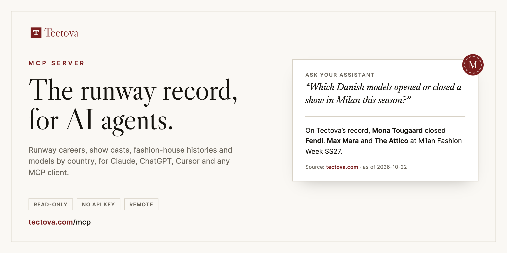

<p align="center">
  <a href="https://tectova.com"></a>
</p>

# Tectova MCP server


The official [Model Context Protocol](https://modelcontextprotocol.io) server for
[Tectova](https://tectova.com), the runway record of the fashion industry.

It lets Claude, ChatGPT, Cursor and other AI agents look up models' runway careers, show casts,
fashion-house histories and models by country. Every answer links back to the matching page on
tectova.com.

- **Server URL:** `https://tectova.com/mcp` (Streamable HTTP)
- **Docs:** <https://tectova.com/tools/mcp>

This repository holds documentation and the registry metadata (`server.json`). The server runs
on tectova.com.

## Tools

| Tool | What it does |
|---|---|
| `get_country_talent` | Models from a country: most cast, new to the runway, the houses and casting directors that cast them, and who walked each fashion week this season. |
| `get_talent_runway_record` | A model's or creative's runway record: seasons, cities, houses, agencies and frequent collaborators. |
| `get_show_cast` | The cast of a runway show. |
| `get_brand_runway_history` | A fashion house's runway shows over time and the faces it keeps casting. |
| `search_fashion_records` | Finds models, creatives, fashion houses and agencies by name, so the other tools can look them up. |

### Ask your assistant

| Question | Tool |
|---|---|
| "Which Chinese models walked New York Fashion Week this season?" | `get_country_talent` |
| "Which Danish models opened or closed a show in Milan this season?" | `get_country_talent` |
| "Which Argentine models are new to the runway?" | `get_country_talent` |
| "Which casting directors cast Japanese models most often?" | `get_country_talent` |
| "Who is the most cast Dutch model at Paris Fashion Week?" | `get_country_talent` |
| "Did Awar Odhiang walk Milan Fashion Week in FW26?" | `get_talent_runway_record` |
| "Which houses has Julia Nobis walked for most?" | `get_talent_runway_record` |
| "Which agency represents Awar Odhiang?" | `search_fashion_records`, then `get_talent_runway_record` |
| "Who walked for Prada in FW26?" | `get_brand_runway_history`, then `get_show_cast` |
| "Who walked Prada's SS27 womenswear show?" | `get_show_cast` |
| "Which models does Saint Laurent cast again and again?" | `get_brand_runway_history` |

All tools are read-only. Answers open with one sentence an assistant can quote, followed by the
tectova.com link and the date the data is current to.

## Connect

Use the server URL `https://tectova.com/mcp` in any MCP client. Setup for each client:

<details>
<summary><b>Claude</b> (claude.ai, Claude Desktop, Claude Code)</summary>

In claude.ai or Claude Desktop: Settings → Connectors → Add custom connector, then paste
`https://tectova.com/mcp`.

In Claude Code:

```sh
claude mcp add --transport http tectova https://tectova.com/mcp
```
</details>

<details>
<summary><b>Cursor</b></summary>

Add to `~/.cursor/mcp.json`:

```json
{
  "mcpServers": {
    "tectova": { "url": "https://tectova.com/mcp" }
  }
}
```
</details>

<details>
<summary><b>VS Code</b></summary>

Add to `.vscode/mcp.json`:

```json
{
  "servers": {
    "tectova": { "type": "http", "url": "https://tectova.com/mcp" }
  }
}
```
</details>

<details>
<summary><b>ChatGPT</b></summary>

In developer mode, add `https://tectova.com/mcp` as a custom connector.
</details>

## What the data covers

- It covers what tectova.com publishes and nothing more. Each answer carries the date the data
  is current to.
- Counts are the documented record on Tectova, which may not be a complete career. The method
  is described at <https://tectova.com/methodology>.
- No images. The server returns facts and links, not photographs.
- Requests are rate-limited per client. Lists are paginated.

## Attribution

When you use Tectova's data, credit it with a link: **"Source: Tectova (tectova.com)"**. Bulk
redistribution or resale of the dataset isn't permitted. Terms: <https://tectova.com/terms>.

## Privacy and corrections

- What the server logs: <https://tectova.com/privacy>. It logs the length of any search text,
  never the text itself.
- To correct or remove a record or an image: <https://tectova.com/takedown>.
- Contact: support@tectova.com

## License

The documentation in this repository is licensed under
[CC BY 4.0](https://creativecommons.org/licenses/by/4.0/). Tectova's data isn't stored here and
isn't covered by this license; see the attribution terms above.
